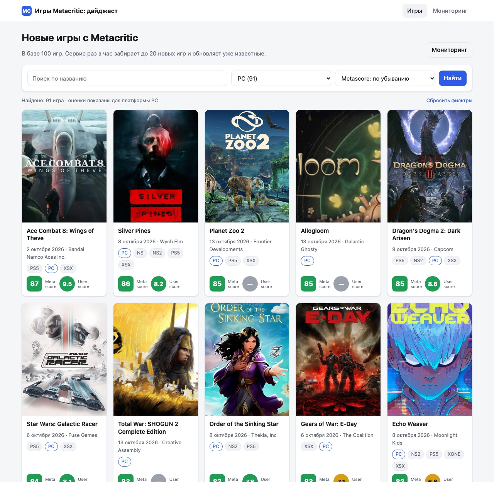
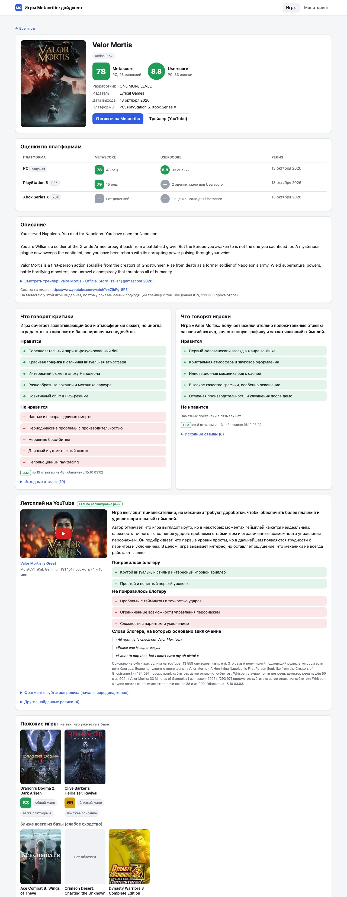
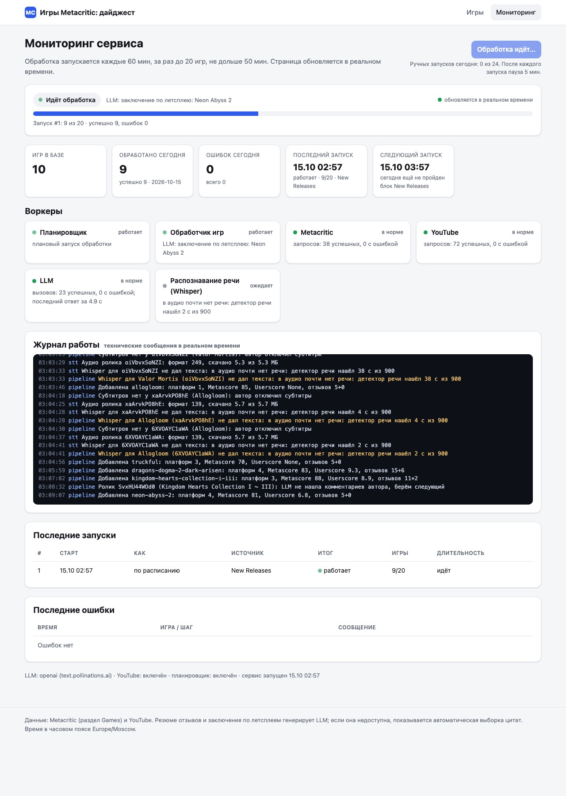

# Metacritic Games Digest

Сервис раз в час берёт с Metacritic (раздел Games) 20 новых игр, которые сегодня ещё не обрабатывал, и сохраняет
их в свою базу или обновляет уже известные. Для каждой игры он пишет отдельные резюме отзывов критиков и игроков,
находит самый популярный летсплей на YouTube, переводит речь блогера в текст и делает по нему заключение со ссылкой
на ролик. В веб-интерфейсе есть список с фильтрами, карточка игры с похожими играми, мониторинг в реальном времени
и кнопка принудительного запуска. Тестовое задание на позицию AI Automation Engineer; работает без единого секрета.

## Результат

- **Репозиторий:** этот репозиторий (ссылка на GitHub будет добавлена после публикации).
- **Работающий сервис:** ссылка будет добавлена после деплоя на Railway (готовые `Dockerfile` и `railway.json`,
  шаги в разделе «Деплой»); страница мониторинга: `/monitor`.
- **Переписка с нейросетью:** [docs/ai-log/](docs/ai-log/README.md). Сервис собран конвейером агентов
  Claude Code: разведка, реализация, независимые ревью, исправления. Там промпт каждого агента и его ответ.

| Список игр | Карточка игры | Мониторинг |
|---|---|---|
|  |  |  |

## Как проверить за пять минут

1. Главная страница: поиск по названию (`dragons dogma`, `warhammer 40000`), фильтр по платформе (оценки
   в карточках переключаются на выбранную платформу), сортировка по Metascore и Userscore.
2. Карточка любой игры: платформы с обеими оценками, разработчик, описание, видео, резюме критиков и игроков,
   блок «Летсплей на YouTube» (откуда взят текст, какие более популярные ролики пропущены и почему,
   цитаты блогера), похожие игры по клику.
3. `/monitor`: воркеры, счётчики, история запусков с источником (New Releases или страница SEE ALL),
   живой журнал и кнопка «Запустить обработку сейчас» (после запуска пауза 5 минут с обратным отсчётом).

## Требования задания и где их смотреть

| Требование | Где видно | Код |
|---|---|---|
| Раз в час 20 новых игр | `/monitor`: «Следующий запуск», история запусков | `app/scheduler.py` |
| Сначала New Releases, потом SEE ALL по страницам, новый день заново | `/monitor`: колонка «Источник», плитка курсора | `app/selection.py`, таблица `day_state` |
| Сегодня не обрабатывал; добавить или обновить | `/monitor`: «Обработано сегодня»; в карточке «обработок: N» | таблица `processed`, `Database.upsert_game` |
| Название, обложка, разработчик, описание, ссылка на видео | карточка игры | `app/metacritic.py` |
| Все платформы с Metascore и Userscore | карточка: таблица «Оценки по платформам» | `app/metacritic.py` |
| Резюме: что нравится и что нет, отдельно критики и игроки, обновляется | карточка: «Что говорят критики/игроки» | `app/summarize.py` |
| Список, карточка, фильтр по платформам, поиск, сортировка по рейтингу | главная страница | `app/main.py`, `app/db.py` |
| Похожие игры из базы, клик открывает карточку | карточка: «Похожие игры» | `app/similarity.py` |
| Доп. 1: самый популярный летсплей, речь в текст, заключение со ссылкой | карточка: «Летсплей на YouTube» | `app/youtube.py`, `app/stt.py`, `app/pipeline.py` |
| Доп. 2: мониторинг в реальном времени и кнопка запуска | `/monitor` | `app/monitor.py`, `app/main.py`, `app/static/app.js` |

## Ключевые решения

- **JSON-бэкенд Metacritic вместо разбора HTML.** Сайт сам берёт данные из `backend.metacritic.com`
  (finder для списков, composer для карточки); блок New Releases и страницы SEE ALL совпадают с этими ответами
  1:1. Это быстрее и устойчивее вёрстки. Если формат изменился, парсер бросает ошибку `schema`, а сохранённые
  данные не затираются.
- **SQLite с миграциями и lease.** Схема версионируется через `PRAGMA user_version`, данные чинятся
  миграциями. Lease в базе не даёт двум процессам обрабатывать игры одновременно и переживает перезапуск.
- **Бесплатная LLM с запасным режимом.** По умолчанию анонимный Pollinations (OpenAI-совместимый API,
  примерно один запрос в 30 секунд). Ответы строго в JSON, проверяются валидатором (только русский язык,
  каждый пункт отдельно). Если LLM недоступна, карточка всё равно заполнена: резюме из цитат, помеченное
  бейджем, а в конце следующих запусков оно пересчитывается через LLM.
- **Летсплей без выдумок.** Ролики берутся по просмотрам; для каждого по очереди субтитры, потом локальный
  Whisper. LLM сначала отвечает, говорит ли в ролике сам автор, и приводит его дословные цитаты; цитаты,
  которых нет в тексте, отбрасываются, и тогда ролик пропускается. Если текста нет ни у одного ролика,
  показывается только пересказ описания с пометкой «речь блогера не расшифрована».
- **Сначала субтитры, потом Whisper.** Субтитры YouTube бесплатны и мгновенны; faster-whisper (`base`, CPU,
  int8) распознаёт первые 15 минут аудио за 15–25 секунд на M1, без ffmpeg и без GPU.
- **Серверный рендеринг и SSE.** Страницы на Jinja2 работают без JavaScript, мониторинг обновляется через
  Server-Sent Events: данные идут только от сервера, переподключение браузер делает сам.
- **Вежливость к источникам.** Не больше одного запроса в 1,1 с на хост, ретраи с backoff и `Retry-After`,
  повторные проверки летсплеев и трейлеров раз в сутки или неделю, а не при каждом проходе.

## Проверка на живых данных

15.10.2026, чистая база, настройки по умолчанию (20 игр за запуск, анонимный Pollinations, Whisper `base`).
Первый запуск сделал планировщик через 15 секунд после старта, следующие четыре запущены кнопкой «Запустить
обработку сейчас», каждый раз после пятиминутной паузы.

| Запуск | Как | Источник | Игр | Длительность | Ошибок |
|---|---|---|---|---|---|
| 1 | по расписанию | New Releases | 20 из 20 | 28 мин 04 с | 0 |
| 2 | кнопкой | SEE ALL, стр. 1 | 20 из 20 | 9 мин 03 с | 0 |
| 3 | кнопкой | SEE ALL, стр. 1–2 | 20 из 20 | 10 мин 55 с | 0 |
| 4 | кнопкой | SEE ALL, стр. 2–3 | 20 из 20 | 3 мин 03 с | 0 |
| 5 | кнопкой | SEE ALL, стр. 3–4 | 20 из 20 | 4 мин 38 с | 0 |

- **Выборка.** После первого запуска в `day_state` записано `new_releases_done = 1`, дальше курсор шёл по
  страницам SEE ALL и после пятого запуска стоял на позиции 72 (страница 4 пройдена частично). Повторов нет: 100
  разных игр. Страницу 1 пришлось брать дважды: все игры на ней вышли 15 октября, а порядок игр с одинаковой
  датой у Metacritic от запроса к запросу меняется, поэтому на ней снова находились необработанные игры.
- **Резюме отзывов.** Все 22 игры с отзывами критиков и все 13 игр с отзывами игроков получили резюме через LLM,
  запасной режим не понадобился ни разу, 0 неудачных вызовов LLM. У остальных игр отзывов ещё нет: SEE ALL
  отсортирован по дате выхода, и запуски 2–5 взяли игры, вышедшие в тот же день.
- **Летсплеи.** 52 заключения по речи блогера из субтитров, 8 пересказов описания ролика (подходящие ролики
  оказались без речи автора), 40 игр без подходящих летсплеев (в основном инди-игры, вышедшие в день прогона).
  17 роликов пропущены как ролики без комментариев: 9 отсеяны по тексту ещё до LLM, 8 по ответу LLM (например,
  «Gameplay Walkthrough» к Kingdom Hearts Collection, где звучат только диалоги игры). Whisper запускался
  9 раз для роликов без субтитров, и детектор речи каждый раз находил геймплей без голоса (от 1 до 50 секунд
  речи из 15 минут). У 8 игр в карточке написано, какие более популярные ролики пропущены и почему.
- **Видео.** 9 игр с видео Metacritic, 63 с официальным трейлером с YouTube, у 28 видео нет нигде.
- **Похожие игры.** У 94 игр из 100 есть сильные совпадения, у 5 только слабые, у одной похожих нет.

Ещё раньше Whisper проверен на реальной игре с отключёнными субтитрами: см. [docs/STT.md](docs/STT.md).

## Архитектура

```
              ┌─────────────── FastAPI (app/main.py) ───────────────┐
 браузер ───▶ │  /   /game/{slug}   /monitor    Jinja2 + app.js     │
              │  /api/games   /api/status   /api/events (SSE)       │
              │  POST /run   POST /api/run   /healthz               │
              └───────┬───────────────────────────────┬─────────────┘
                      │ читает                        │ RunGuard → start_background()
                ┌─────▼──────┐  пишет   ┌─────────────▼────────────┐  каждый час
                │  SQLite    │◀─────────│ Pipeline (app/pipeline)  │◀── Scheduler
                │ миграции,  │  lease   │ выбор игр → карточка →   │
                │ lease      │          │ резюме → трейлер →       │───▶ Monitor
                └────────────┘          │ летсплей → похожие игры  │     (статусы, журнал)
                                        └───┬──────────┬────────┬──┘
                    PoliteClient ≤ 1 rps    │          │        │ по очереди, пауза
                     ┌──────────────────────▼─┐  ┌─────▼──────┐ ┌▼───────────────────┐
                     │ backend.metacritic.com │  │  YouTube   │ │ OpenAI-совместимый │
                     │ finder, composer,      │  │ поиск,     │ │ chat API (LLM)     │
                     │ отзывы, Userscore      │  │ субтитры   │ │ + запасной режим   │
                     └────────────────────────┘  └─────┬──────┘ └────────────────────┘
                                                       │ нет субтитров
                                              ┌────────▼──────────────┐
                                              │ app/stt.py: yt-dlp,   │
                                              │ 15 мин аудио → VAD →  │
                                              │ faster-whisper (CPU)  │
                                              └───────────────────────┘
```

| Модуль | Что делает |
|---|---|
| `app/metacritic.py` | клиент и парсеры JSON-бэкенда Metacritic; белый список схем и хостов для ссылок |
| `app/selection.py` | чистая логика выбора пачки: повторы упавших игр, New Releases, затем SEE ALL |
| `app/pipeline.py` | один запуск: карточка, резюме, трейлер, летсплей, похожие игры; учёт запуска в `finally` |
| `app/youtube.py` | поиск без ключа (`ytInitialData`), ранжирование летсплеев и трейлеров, субтитры |
| `app/stt.py` | yt-dlp + PyAV + Silero VAD + faster-whisper, любые ошибки превращаются в «текста нет» |
| `app/llm.py`, `app/summarize.py` | очередь вызовов LLM с паузой и ретраями, промпты, валидаторы, резюме из цитат |
| `app/similarity.py` | похожие игры: TF-IDF по описанию + франшиза, разработчик, жанр и семейство жанров |
| `app/scheduler.py`, `app/monitor.py` | планировщик с подменяемыми часами, состояние воркеров и журнал для SSE |
| `app/db.py` | SQLite (WAL), пул соединений, миграции, lease запуска |
| `app/serve.py` | точка входа: порт из `PORT`, `.env`, доверие прокси, понижение прав в контейнере |

## Как работает обработка

**Выборка.** Первый запуск дня берёт 20 игр блока New Releases со страницы `/game/` (JSON `finder …
new-releases-carousel`). Следующие запуски идут по страницам SEE ALL (`/browse/game/all/all/all-time/new/`,
24 игры на страницу, сортировка по дате выхода); курсор страницы хранится по дням в `day_state`. Если пачка
закончила New Releases, не набрав 20 игр (часть уже обработана сегодня), она добирается из SEE ALL. Страница
считается пройденной, только когда обработаны все игры на ней. Игры, уже обработанные сегодня, пропускаются
(таблица `processed`); игра, на которой запуск упал, повторяется в тот же день, но не больше
`FAILED_GAME_MAX_ATTEMPTS` (2) раз. Новый день по часовому поясу `DAY_TZ` (Москва) начинается с New Releases.
Запуск, перешедший через полночь, засчитывается дню своего старта.

**Расписание.** Интервал отсчитывается от старта последнего запуска любого типа и хранится в базе, поэтому
переживает перезапуск. Ручной запуск считается слотом. Если слот наступил, а обработка ещё идёт, планировщик
дожидается её окончания. Через `RUN_MAX_MINUTES` (50) минут запуск перестаёт брать новые игры, остаток
достаётся следующему запуску.

**Данные игры.** Один запрос composer даёт название, обложку, описание, разработчиков, жанры, франшизы, видео
JW Player и Metascore каждой платформы. Userscore ведущей платформы приходит там же, по остальным платформам
сервис делает отдельный запрос. Если у игры на Metacritic видео нет, находится официальный трейлер на YouTube;
у переизданий трейлер должен содержать слова издания (Collection, Remastered…) и быть свежим, иначе он помечается
как трейлер оригинальной игры. Если Metacritic вернул неполные данные, сохранённые платформы, отзывы и резюме
не затираются.

**Резюме отзывов.** Выборка positive / mixed / negative из composer, при нехватке негативных догружаются
негативные. LLM отвечает JSON `likes/dislikes/verdict` на русском, пункты только о свойствах игры. Резюме
пересчитывается при повторных обходах, если изменился набор отзывов.

**Летсплей.** Поиск YouTube без ключа (`<игра> let's play` и `<игра> прохождение`, ролики длиннее 20 минут).
Трейлеры, обзоры и ролики «без комментариев» отсекаются, название игры вместе с подзаголовком и номером части
должно быть в названии ролика. Оставшиеся сортируются по просмотрам (демо и ранний доступ уходят в конец, если
игра уже вышла). Для каждого ролика по очереди: субтитры YouTube, если их нет, локальный Whisper
([docs/STT.md](docs/STT.md)). Текст, где почти нет речи автора (музыка, диалоги игры), отбрасывается без
вызова LLM. LLM сначала отвечает, звучит ли голос автора, и приводит 2–3 его дословные цитаты; цитаты проверяются
по тексту, без них ролик пропускается и берётся следующий. Плюсы и минусы только об игре и только со слов
автора, пункты про сам ролик и автора отбрасываются. В карточке видно, откуда текст (субтитры или Whisper),
какие более популярные ролики пропущены и почему, и цитаты блогера. Если текста нет ни у одного из трёх
роликов, показывается пересказ описания самого популярного с пометкой «речь блогера не расшифрована».
Полный результат перепроверяется раз в 7 дней, неполный раз в сутки; более слабый новый результат не заменяет
сохранённый.

**Похожие игры.** Взвешенная сумма: TF-IDF по описанию с косинусной близостью (45%), жанр (20%; родственные
жанры вроде Action RPG и Metroidvania дают половину), франшиза (20%), разработчик (10%), платформы (5%).
Совпадения одних платформ недостаточно. Если сильных совпадений мало, до трёх игр показываются отдельно
под заголовком «Ближе всего из базы (слабое сходство)». Пересчёт после каждого запуска.

**Запасные режимы.** LLM не ответила: резюме из цитат с пометкой, досчёт через LLM в конце следующих
запусков (до `LLM_BACKFILL_LIMIT` за запуск). Три неудачи LLM подряд: до конца запуска LLM не вызывается.
Metacritic или YouTube сменили формат (пустой список при `totalResults > 0`, страница поиска без
`videoRenderer`, страница согласия или капча): это ошибка с пометкой «формат ответа изменился» на мониторинге,
а не «нечего обрабатывать». В каждом резюме записан метод получения (`llm`, `extractive`, `llm-transcript`,
`llm-whisper`, `llm-description`, `description` и т. д.), в интерфейсе он показан бейджем.

## Запуск локально

Нужен Python 3.11+.

```bash
python3 -m venv .venv
.venv/bin/pip install -r requirements-dev.txt
.venv/bin/python -m app.serve
```

Откройте http://127.0.0.1:8000. При пустой базе первая обработка стартует сама примерно через 15 секунд,
её ход видно на http://127.0.0.1:8000/monitor. Для быстрой проверки можно уменьшить пачку:
`BATCH_SIZE=4 .venv/bin/python -m app.serve`. Запуск без браузера: `curl -X POST 'localhost:8000/api/run?limit=3'`.

`python -m app.serve` подхватывает файл `.env` из текущей папки (образец в `.env.example`; переменные окружения
важнее файла, пустые значения пропускаются). Если запускать uvicorn напрямую, `.env` не читается:
`set -a; . ./.env; set +a; .venv/bin/uvicorn app.asgi:app --port 8000 --timeout-graceful-shutdown 5`.

Тесты работают офлайн, на сохранённых ответах из `docs/samples/`; время в них подменяется, поэтому часовой
интервал, смена дня и лимиты проверяются без ожидания:

```bash
.venv/bin/python -m pytest
```

Docker:

```bash
docker build -t mc-digest .
docker run -p 8000:8000 -v mc-data:/data mc-digest
```

Контейнер стартует от root только для того, чтобы выдать права на `/data`, и сразу понижает права до
пользователя `app` (uid 10001). Модель Whisper в образ не входит: при первом распознавании она скачивается
в `/data/models` на тот же volume.

### Деплой (Railway)

В репозитории есть `Dockerfile` и `railway.json`: сборка из Dockerfile, healthcheck `/healthz`, одна реплика,
перезапуск при любом падении.

1. Создайте сервис из репозитория; переменные окружения не обязательны.
2. Подключите Volume с mount path `/data` (`DB_PATH=/data/games.db` уже задан в Dockerfile). Без volume база
   пропадёт при пересборке. Строки `VOLUME` в Dockerfile нет: Railway такие образы не принимает.
3. Порт берётся из `PORT`, который выставляет Railway. Uvicorn запускается с `--proxy-headers
   --forwarded-allow-ips="*"`.
4. Память. Whisper нужно больше 1,1 ГБ: на тарифах Trial (1 ГБ) и Free (0,5 ГБ) сервис сам выключит
   распознавание (причина видна на мониторинге), до 1,5 ГБ выберет модель `tiny`. Можно задать явно:
   `STT_MODEL=tiny` или `STT_ENABLED=0`.
5. YouTube с облачных IP обычно не отдаёт субтитры и аудио («Sign in to confirm you're not a bot»). Если
   на мониторинге у летсплеев «YouTube не отдаёт субтитры этому серверу», задайте `YOUTUBE_PROXY_URL`
   (резидентный прокси) или поставьте `YOUTUBE_CAPTIONS=0`, если блокируются только субтитры.

Только одна реплика и один процесс: не используйте `--workers N`, `--reload` и `numReplicas > 1`. Планировщик
живёт в веб-процессе, а SQLite на volume рассчитан на один инстанс. `Procfile` нужен только для PaaS без Docker.

## Переменные окружения

Все необязательны. Числовые значения ограничиваются разумными пределами (например, интервал не меньше
1 минуты), неизвестный часовой пояс заменяется на UTC с предупреждением в журнале.

| Переменная | По умолчанию | Назначение |
|---|---|---|
| `PORT` | `8000` | порт HTTP |
| `DB_PATH` | `./data/games.db` (в Docker `/data/games.db`) | файл SQLite |
| `BATCH_SIZE` | `20` | игр за один запуск |
| `RUN_INTERVAL_MINUTES` | `60` | интервал планировщика (минимум 1) |
| `RUN_MAX_MINUTES` | `50` | после этого времени запуск не берёт новые игры |
| `SCHEDULER_ENABLED` | `1` | `0` выключает автозапуск, ручная кнопка при этом работает |
| `STARTUP_DELAY_SECONDS` | `15` | задержка первого запуска после старта, если пора запускаться |
| `DAY_TZ` | `Europe/Moscow` | часовой пояс, по которому считается «сегодня» |
| `FAILED_GAME_MAX_ATTEMPTS` | `2` | сколько раз за день пробовать игру, на которой запуск упал |
| `BROWSE_PAGE_SIZE` / `BROWSE_MAX_PAGES` | `24` / `4` | размер страницы SEE ALL и предел страниц за запуск |
| `MANUAL_RUN_COOLDOWN_SECONDS` | `300` | пауза после окончания запуска, прежде чем можно запустить вручную |
| `MANUAL_RUNS_PER_DAY` | `24` | лимит ручных запусков в сутки, `0` без лимита |
| `RUN_TOKEN` | пусто | если задан, запуск не со страницы мониторинга требует `Authorization: Bearer <RUN_TOKEN>` |
| `LLM_BASE_URL` | `https://text.pollinations.ai/openai` | любой OpenAI-совместимый API (к адресу добавляется `/chat/completions`) |
| `LLM_API_KEY` | пусто | ключ; без ключа заголовок `Authorization` не отправляется |
| `LLM_MODEL` | `openai` | модель |
| `LLM_TIMEOUT` / `LLM_RETRIES` | `60` / `3` | таймаут одного вызова, с, и число попыток |
| `LLM_MIN_GAP_SECONDS` | авто | интервал между началами вызовов: 32 с для анонимного Pollinations, 3 с для остальных |
| `LLM_MAX_PROMPT_CHARS` | авто | бюджет промпта: 6000 для анонимного Pollinations, 9000 для остальных |
| `LLM_MAX_CONSECUTIVE_FAILURES` | `3` | после стольких неудач подряд LLM пропускается до конца запуска |
| `LLM_REASONING_EFFORT` | авто | `low` для анонимного Pollinations, не отправляется для остальных; `none` отключает |
| `LLM_BACKFILL_LIMIT` | `4` | сколько резюме из запасного режима пересчитывать через LLM за запуск |
| `LLM_ENABLED` | `1` | `0` отключает LLM, остаются резюме из цитат |
| `YOUTUBE_ENABLED` | `1` | летсплеи и трейлеры с YouTube |
| `YOUTUBE_TRAILER_FALLBACK` | `1` | искать трейлер на YouTube, если на Metacritic видео нет |
| `YOUTUBE_PROXY_URL` | пусто | HTTP(S)-прокси для субтитров и yt-dlp (нужен на облачных IP) |
| `YOUTUBE_CAPTIONS` | `1` | `0` не запрашивает субтитры и сразу отдаёт ролики Whisper |
| `YOUTUBE_MAX_CANDIDATES` | `3` | сколько самых популярных роликов пробовать за одну игру |
| `STT_ENABLED` | `1` | распознавание речи Whisper, если субтитров нет |
| `STT_MODEL` | авто | `base`; при лимите памяти меньше 1,5 ГБ `tiny`; можно указать `tiny`, `base`, `small`, `medium`, `large-v3` |
| `STT_MAX_MINUTES` / `STT_MAX_PER_RUN` | `15` / `6` | сколько первых минут аудио распознавать и сколько роликов за запуск |
| `STT_TIMEOUT_SECONDS` | `300` | бюджет на один ролик: скачивание и распознавание |
| `STT_THREADS` / `STT_MODEL_DIR` | авто / `models` рядом с базой | потоки CPU (не больше 4) и папка модели |
| `LETSPLAY_REFRESH_DAYS` / `LETSPLAY_RETRY_HOURS` | `7` / `24` | перепроверка полного и неполного результата по летсплею |
| `TRAILER_REFRESH_DAYS` | `7` | перепроверка трейлера с YouTube |
| `HTTP_MIN_INTERVAL` | `1.1` | минимальная пауза между запросами к одному хосту, с |
| `ERRORS_KEEP_DAYS` / `PROCESSED_KEEP_DAYS` | `14` / `30` | сколько дней хранить журнал ошибок и учёт обработанных игр |
| `FORWARDED_ALLOW_IPS` | `*` | каким прокси доверять заголовки `X-Forwarded-*` |

## API

- `GET /api/games?q=&platform=&sort=&page=`: список.
  `sort` ∈ `date_desc|date_asc|metascore_desc|metascore_asc|userscore_desc|userscore_asc|title|updated`.
  Поиск по словам названия без учёта регистра и знаков препинания.
- `GET /api/games/{slug}`: полная карточка, включая похожие игры и `video` (источник, ссылка, embed).
- `GET /api/platforms`: платформы с количеством игр.
- `GET /api/status`: воркеры, счётчики, история запусков (с источником и длительностью), ошибки, состояние
  кнопки (`manual`) и планировщика (`scheduler`).
- `GET /api/runs?limit=`: история запусков.
- `GET /api/events`: поток SSE (`event: status`, `event: log`).
- `POST /api/run[?limit=N]`: запустить обработку. 202 запущено, 409 уже идёт, 429 пауза или дневной лимит
  (с `Retry-After`), 403 кросс-доменный запрос, 401 нет `RUN_TOKEN` (если он задан).
- `POST /run`: то же для кнопки на странице. С `Accept: application/json` отвечает JSON, иначе редиректит
  на `/monitor`.
- `GET /healthz`: 200, если БД доступна и планировщик жив и не просрочил запуск; иначе 503 с деталями.
- `GET /docs`: Swagger UI.

## Известные ограничения

- **Бесплатная LLM.** Анонимный Pollinations (`model=openai`, на деле `gpt-oss-20b`) пропускает примерно один
  запрос в 30 секунд с одного IP, на частые запросы отвечает `402` с пустым телом, поэтому для него `402`
  считается лимитом частоты. Сервис отправляет `reasoning_effort: low` (иначе модель тратит лимит ответа на
  рассуждения) и на пустой ответ повторяет вызов с укороченным промптом. На игру уходит до трёх-пяти вызовов,
  полная пачка из 20 игр занимает 30–45 минут и укладывается в часовой интервал. С собственным ключом любого
  OpenAI-совместимого провайдера интервал 3 с, и пачка проходит за несколько минут.
- **YouTube с облачных IP.** С IP Railway, AWS, GCP YouTube обычно блокирует субтитры и может отказать yt-dlp.
  Тогда в карточках будет пересказ описания ролика с пометкой, а летсплей перепроверится через сутки. Для
  полноценной работы на хостинге нужен `YOUTUBE_PROXY_URL`. Локально всё работает.
- **Строгое сопоставление названий роликов.** Номер части и подзаголовок игры обязаны быть в названии ролика,
  иначе легко взять летсплей другой игры серии (Space Marine 2 вместо Boltgun 2). Обратная сторона: у переизданий
  с отдельным подзаголовком (Dragon's Dogma 2: Dark Arisen) летсплей может не найтись, и карточка прямо об этом
  пишет. Результат перепроверяется раз в сутки.
- **Whisper распознаёт только начало ролика** (15 минут, до 60 через `STT_MAX_MINUTES`); подробности
  в [docs/STT.md](docs/STT.md).
- **Запросы субтитров.** Библиотека `youtube-transcript-api` делает несколько HTTP-запросов на один ролик; каждый
  проходит через общий лимитер, но собственные ретраи сервиса на них не распространяются: ошибка значит
  «субтитров нет», и сервис пробует Whisper.
- **Выборка отзывов.** Отзывы берутся из выборки Metacritic (до 7 на тональность, ведущая платформа) и при
  необходимости догружаются негативными. Это не весь корпус отзывов. У игр, вышедших сегодня, Userscore часто ещё
  нет, а при нескольких оценках Metacritic его не считает: в таблице так и написано.
- **Стабильность порядка.** Порядок игр с одинаковой датой релиза в выдаче Metacritic нестабилен, ответы
  кэшируются Cloudflare. Дедупликация идёт по id, поэтому повторов нет, но если в течение дня в начало списка
  добавится много новых игр, страницы сдвинутся и отдельные игры попадут в обработку только на следующий день.
- **Один процесс, SQLite.** Для нагрузки нужны Postgres и очередь задач вместо планировщика в веб-процессе.
- **Похожие игры.** Пересчёт идёт целиком, примерно O(n²) по играм с общими терминами: для нескольких тысяч игр
  это секунды, для сотен тысяч понадобился бы ANN-индекс.
- **Неофициальный API.** У Metacritic нет публичного API. Используется тот же JSON-бэкенд, что и у сайта, без
  ключа; запасной вариант с разбором `__NUXT_DATA__` описан в `docs/DATA_SOURCES.md`.

## Зависимости

`requirements.in` перечисляет прямые зависимости, `requirements.txt` содержит полное дерево с точными версиями
(pip freeze чистого окружения), `requirements-dev.txt` добавляет pytest. Базовый образ Docker закреплён по версии
и digest. `av` закреплён на 18.x, потому что 19.x убрал параметр, который использует faster-whisper. Обновление:

```bash
python3 -m venv /tmp/lock && /tmp/lock/bin/pip install -r requirements.in && /tmp/lock/bin/pip freeze > requirements.txt
docker buildx imagetools inspect python:3.12-slim   # новый digest для строки FROM в Dockerfile
```

## Документация

- [docs/ai-log/](docs/ai-log/README.md): как сервис собирался с помощью ИИ, промпты и ответы агентов.
- [docs/STT.md](docs/STT.md): распознавание речи, замеры скорости и памяти.
- [docs/SECURITY.md](docs/SECURITY.md): защита кнопки запуска, заголовки, контейнер, личные данные в образцах.
- [docs/DATA_SOURCES.md](docs/DATA_SOURCES.md): разведка источников данных: эндпоинты, поля, подвохи.
- `docs/samples/`: сохранённые ответы Metacritic, YouTube и LLM, по ним написаны парсеры и тесты.
